Kvisser: A self hosted quiz platform. 
The goal of this project is to build a locally hosted service to replace services like kahoot. 
Built with react as the frontend framework and expressJS as the backend.
Currently in very early development.

Try it: https://kvisser.santtu.uk

How to access the available features:
 - Both the quiz page and the ability to host lobbies are viewable when clicking on the hostable example quiz on the carousel on the first carousel in the home screen
 - To host the example quiz click the host button in the example quizzes page and then continue or login and try again. 
 - You can join a room by clicking on the play button and then typing in the 6 letter code visible on the hosts screen and then your chosen username.
 - To access to login/logout and sign up pages click on the login button in the top right corner of the site
 - To start a game, get at least one player in the room and then press start. This is also how you can see the multiple choice page.
 - The correct answer for the demo quiz is always answer 1
 - To access the leaderboard press the leaderboard button as the host after the time is up or everyone has answered
 - You'll see the status page after answering a question as the player

Note: the page for changing your password exists but there is currently no ui element to access it. To change password go to: https://kvisser.santtu.uk/changepassword.

To test locally:
run "npm i" and "npm run dev" in both the front-end and backend directiories.

Current features that exist:
- The home page
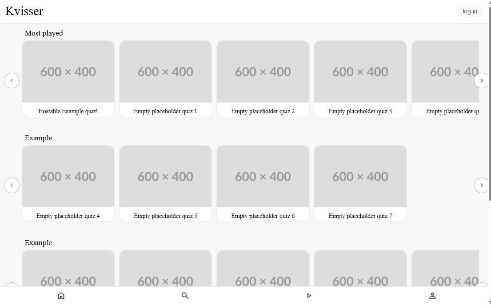
- Quiz pages
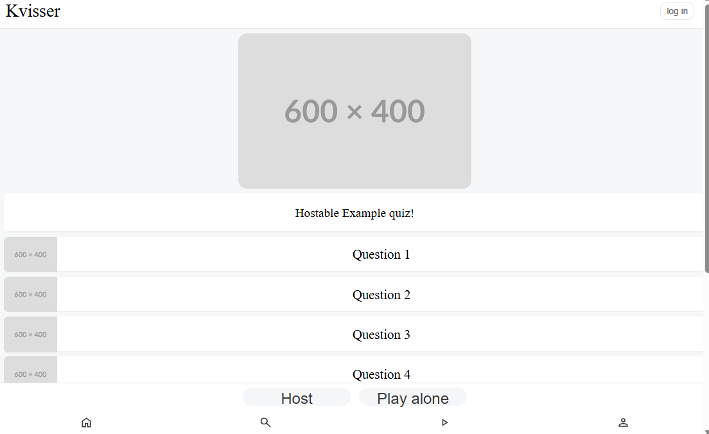
- Hosting a lobby
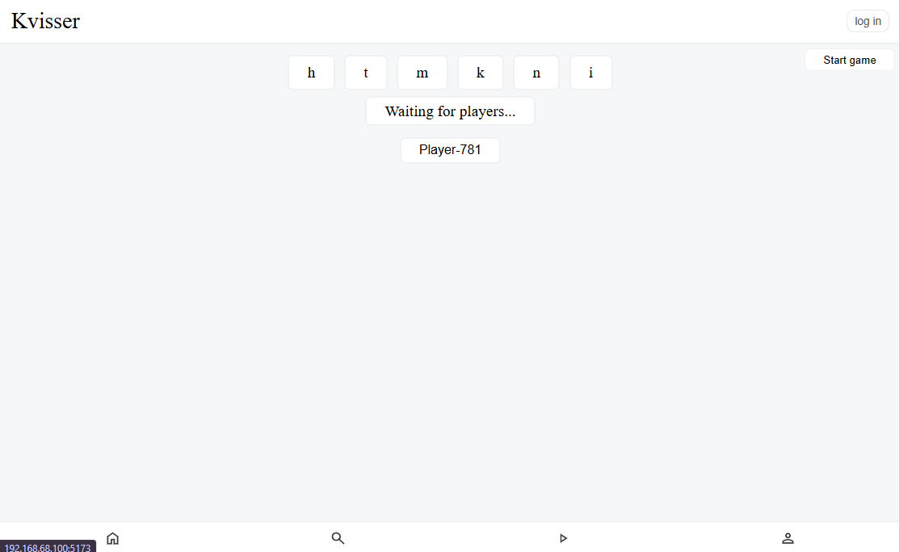
- Joining a lobby
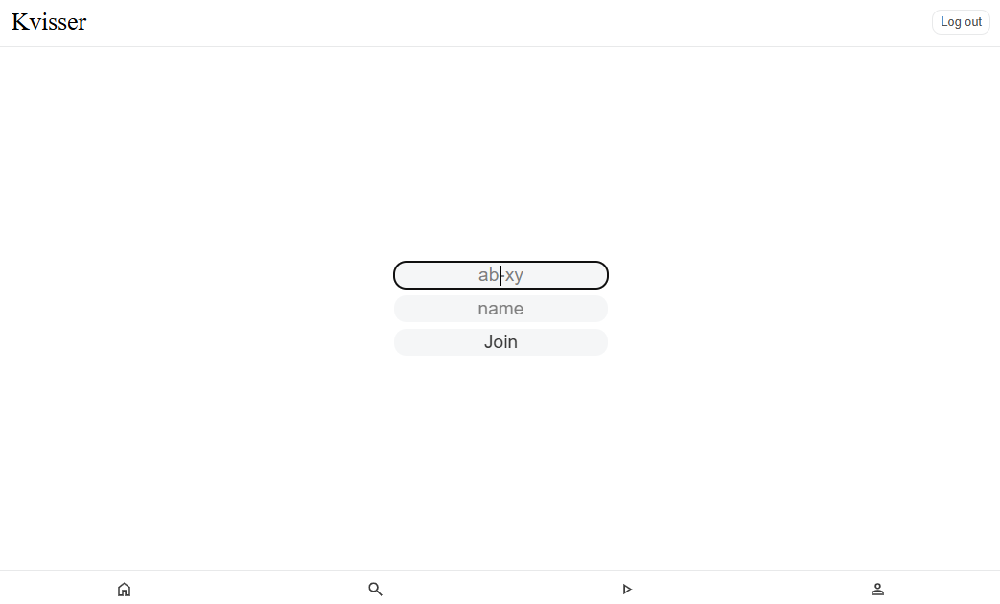
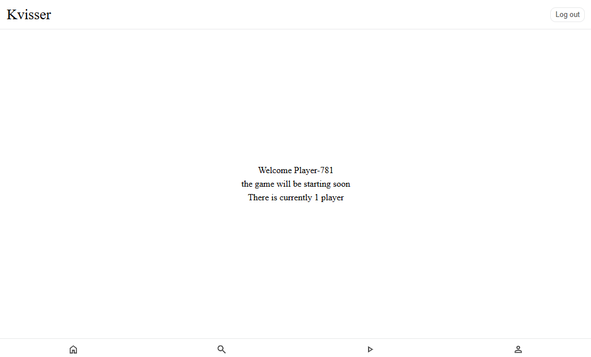
- The front page
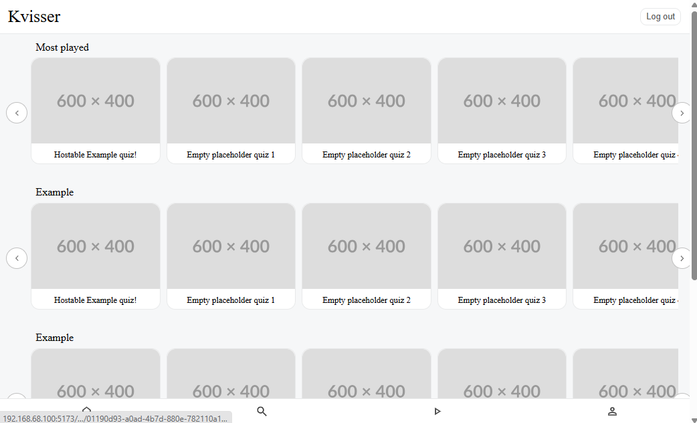
- Auth pages
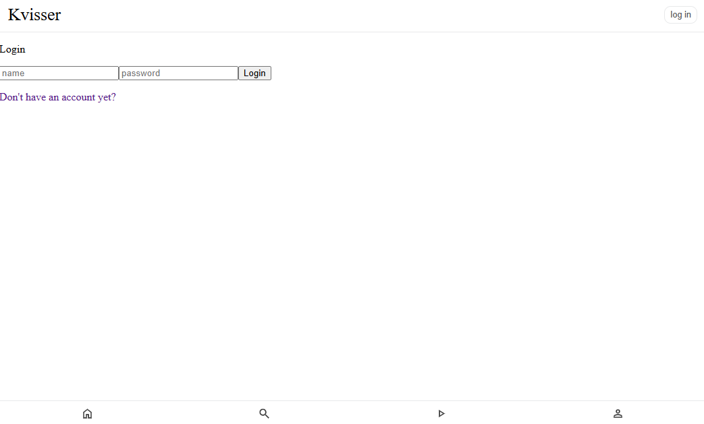
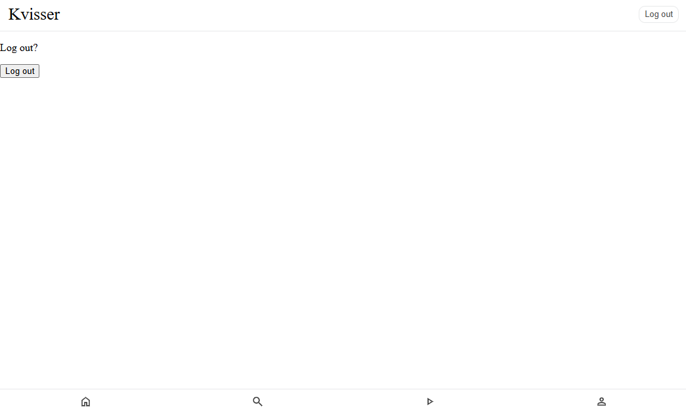
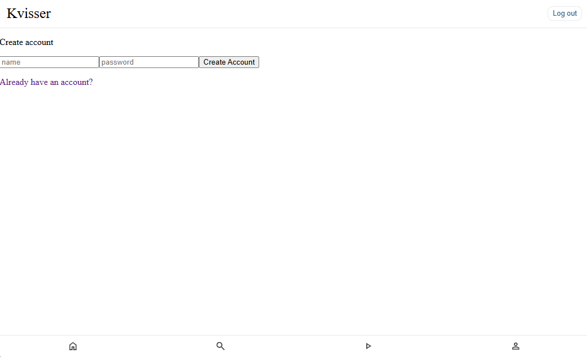
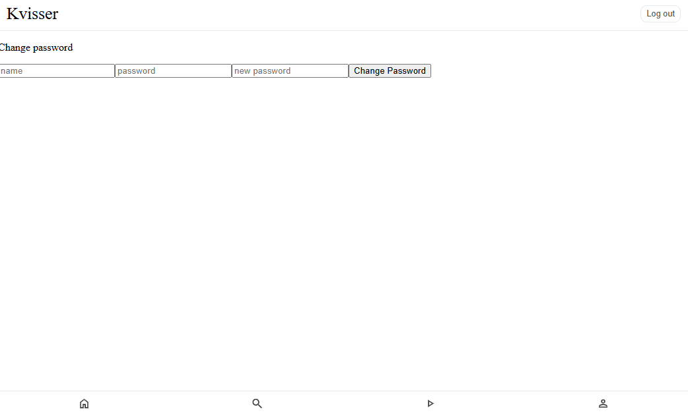
- The multiple choice question page
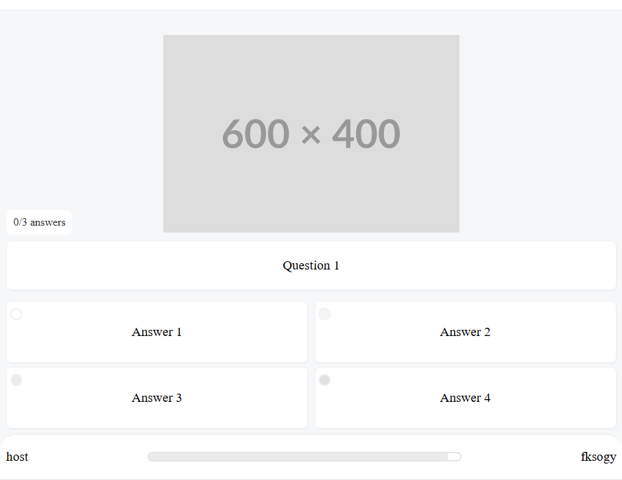
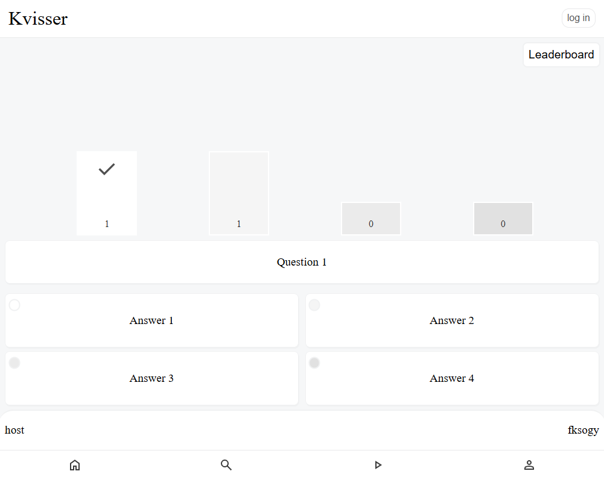
- The leaderboard page
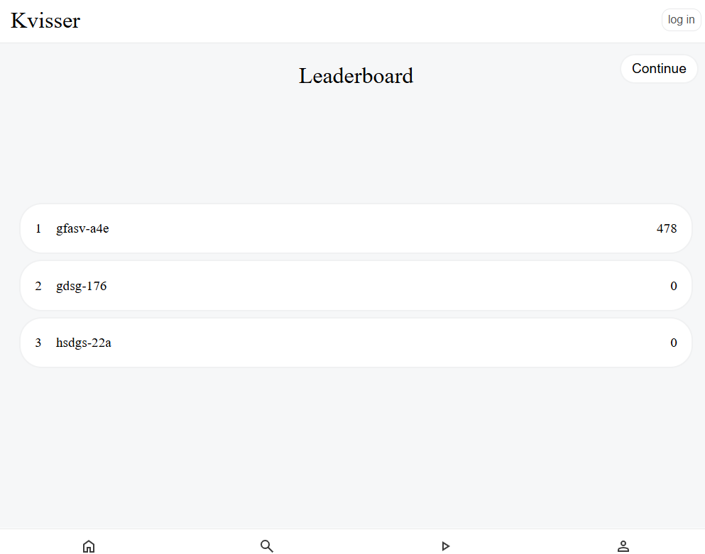
- The status page
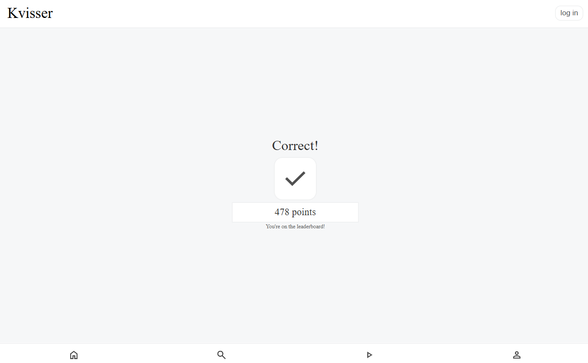
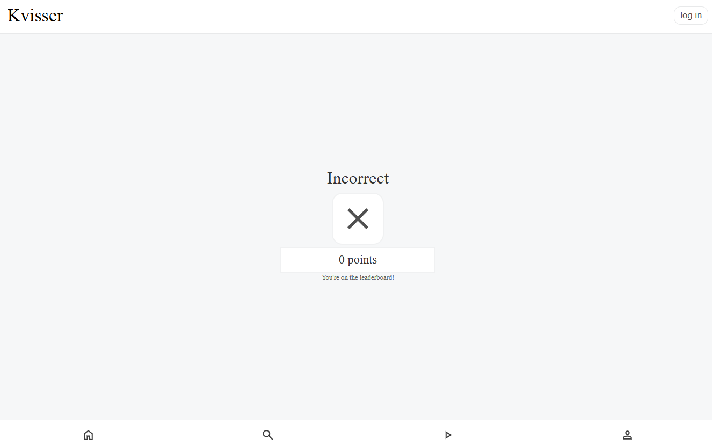
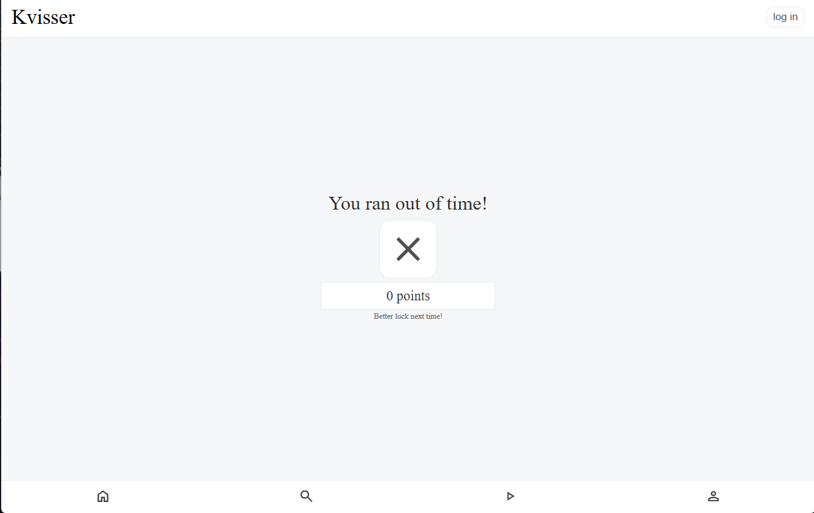

