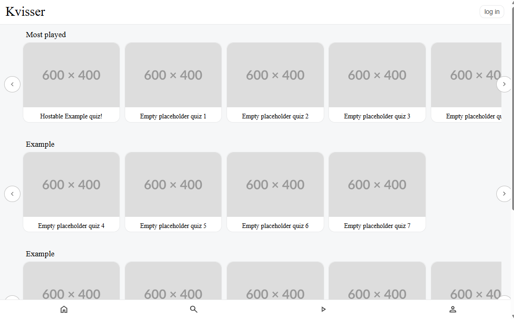
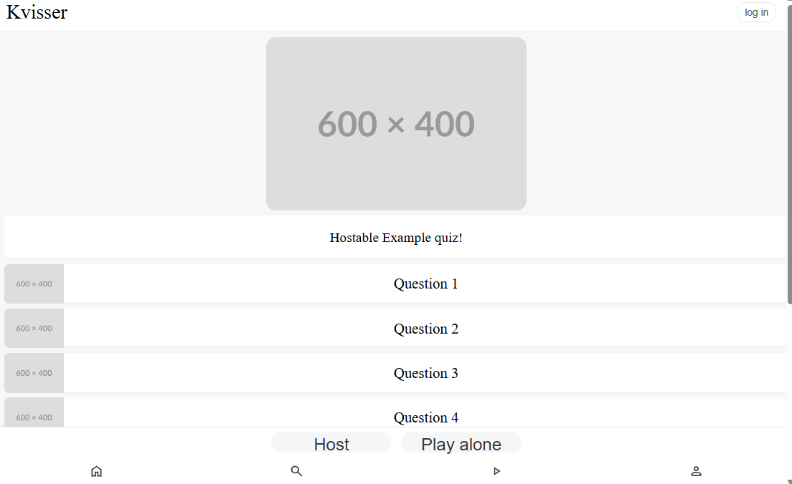
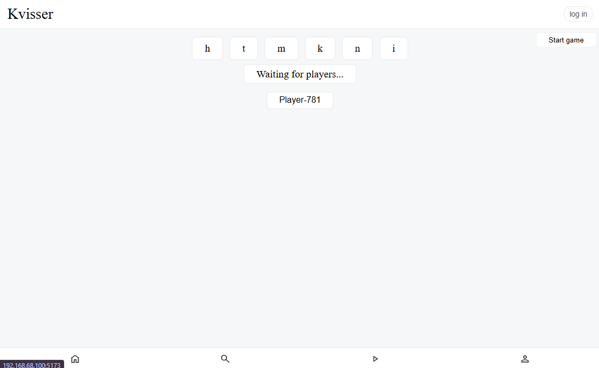
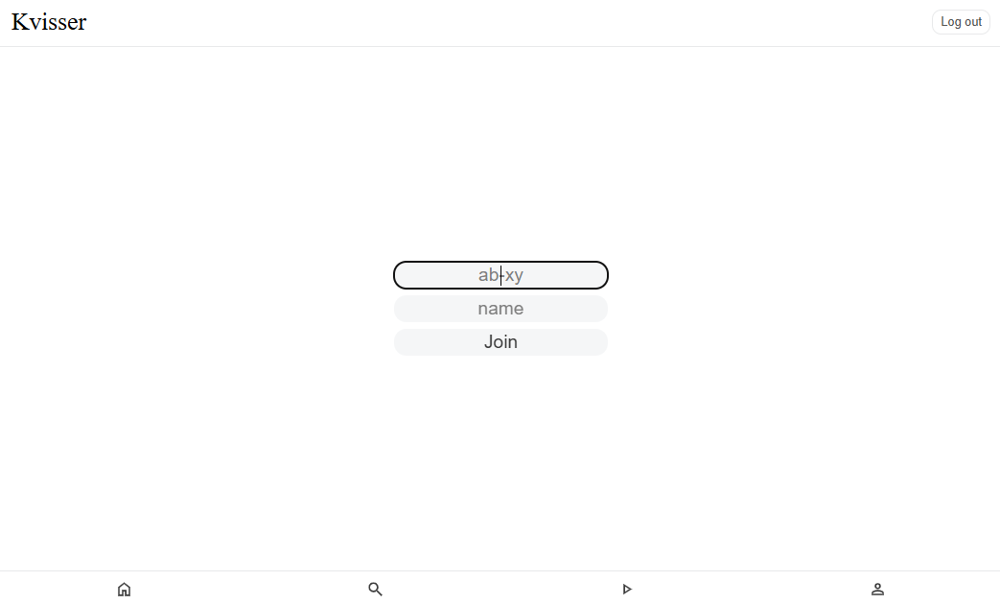
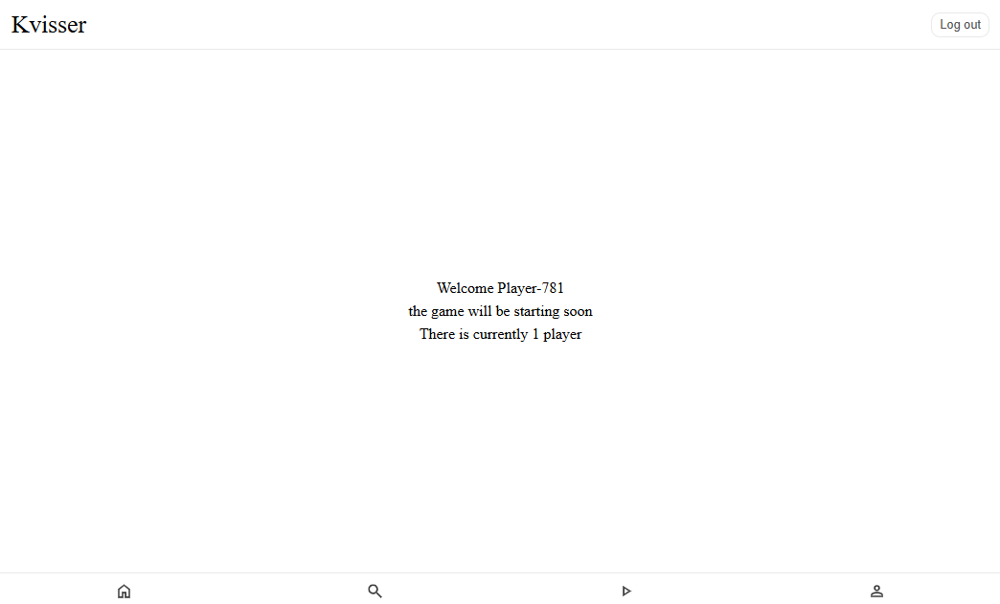
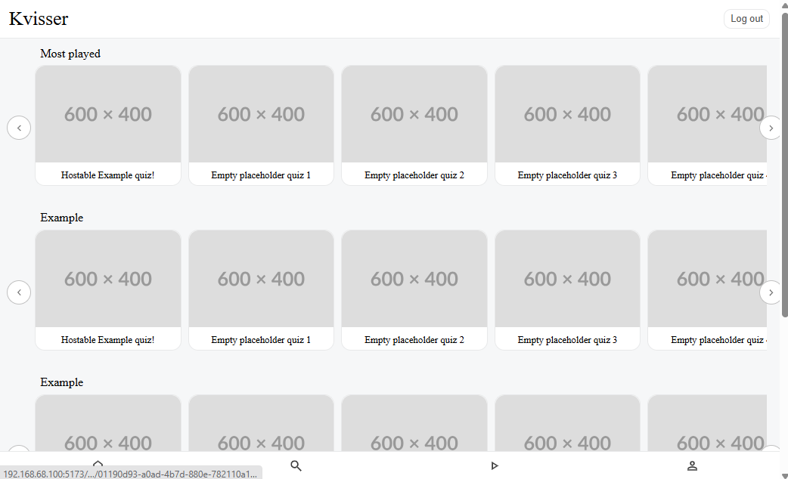
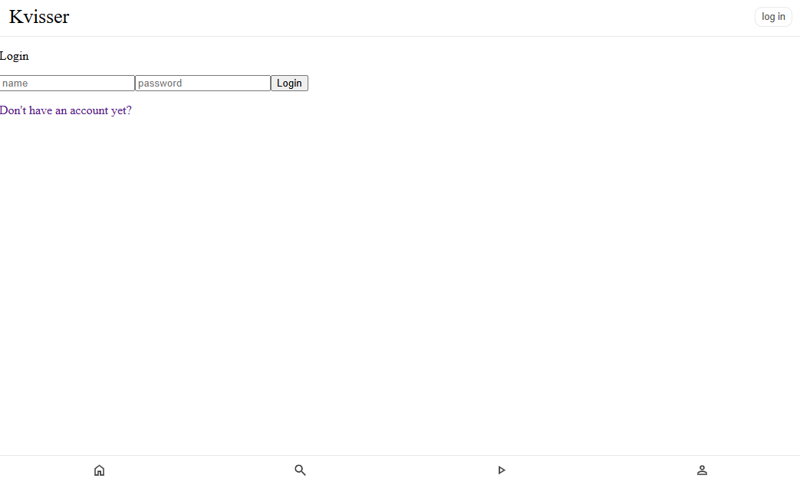
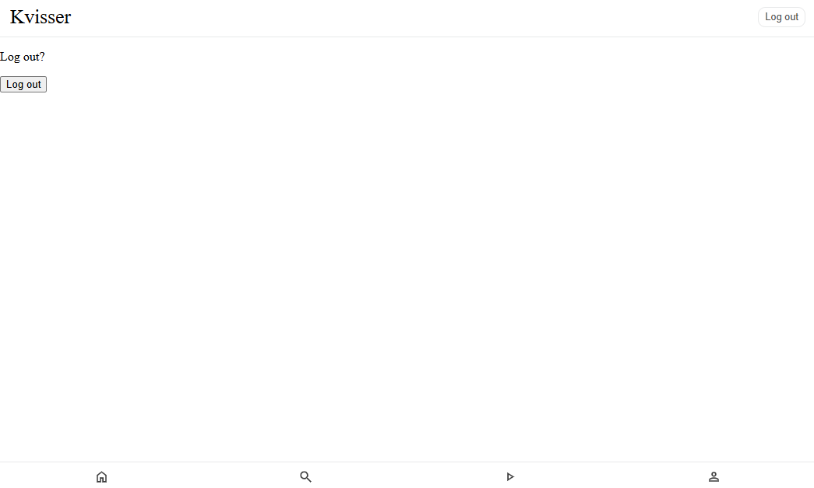
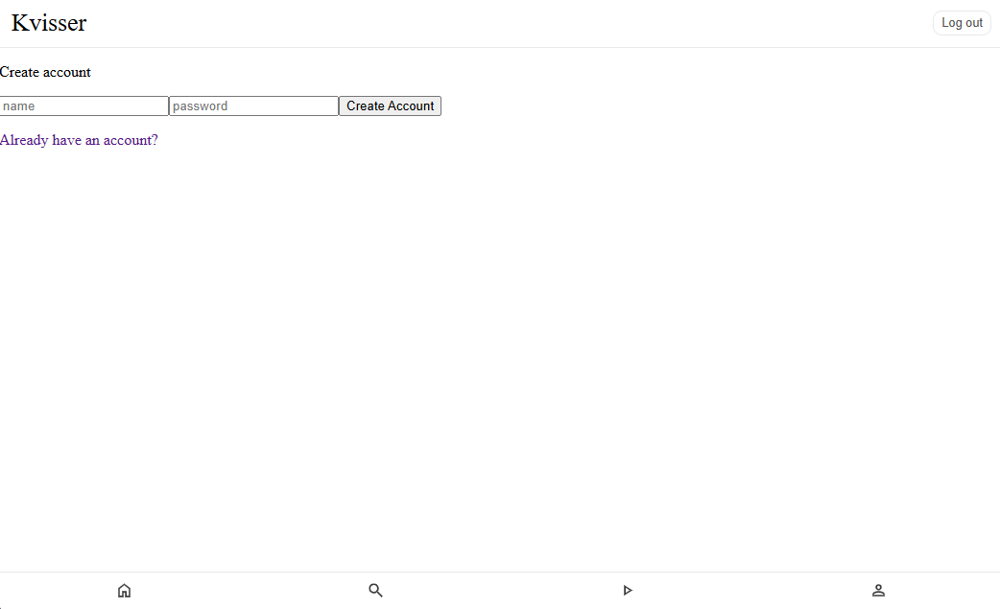
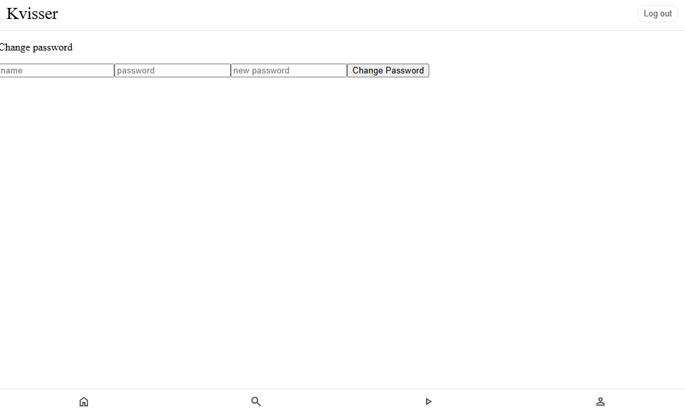

Kvisser: A quiz self hosted platform.
Currently in very early development.

Try it: https://kvisser.santtu.uk

Current features that exist:
- The home page

- Quiz pages

- Hosting a lobby

- Joining a lobby

- The front page

- Auth pages

Note: the page for changing your password exists but there is currently no ui element to access it. To change password go to: https://kvisser.santtu.uk/changepassword.

To test locally:
run "npm i" and "npm run dev" in both the front-end and backend directiories.